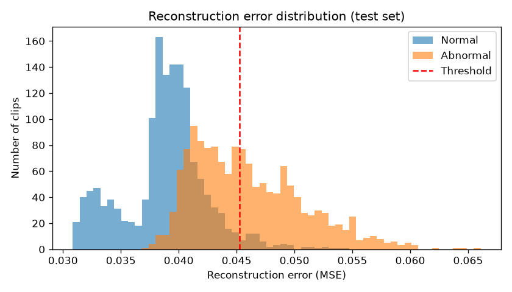
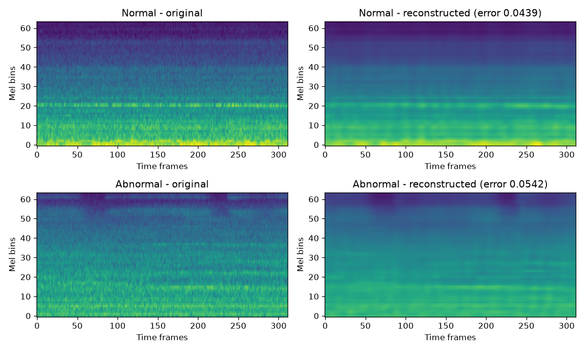

# Machine Sound Anomaly Detection

A deep learning project that listens to an industrial fan and tells whether it sounds normal or may have a fault. The model is trained **only on healthy sounds**, so it never needs examples of faults.

## How it works

1. Each 10-second audio clip is converted into a log-Mel spectrogram (a picture of the sound, size 64 x 312).
2. A CNN autoencoder is trained on **normal clips only**. It squeezes the spectrogram into a small set of numbers and then rebuilds it.
3. For a new clip, the rebuilding error is its **anomaly score**. Unusual sounds are rebuilt badly, so they get a high score.
4. A clip is flagged as abnormal if its score is above a threshold. The threshold is the 95th percentile of scores on **normal validation clips**. Test labels were never used to pick it.

I tried two threshold styles: one threshold for all fans, and one threshold per fan.

## Dataset

[MIMII dataset](https://zenodo.org/records/3384388), **fan recordings at 6 dB noise only**. 4 fans, 5,550 clips (4,075 normal, 1,475 abnormal). The dataset is about 10 GB, so it is not included in this repo.

| Split | Clips | Contents |
|---|---|---|
| Train | 2,342 | normal only |
| Validation | 258 | normal only |
| Test | 2,950 | 1,475 abnormal + 1,475 normal (never seen) |

## Results (test set)

| Method | ROC-AUC | Precision | Recall | F1 |
|---|---|---|---|---|
| Autoencoder, one threshold | 0.904 | 0.92 | 0.50 | 0.65 |
| Autoencoder, threshold per fan | 0.896* | 0.91 | 0.66 | 0.76 |
| Isolation Forest, one threshold | 0.858 | 0.83 | 0.21 | 0.34 |
| Isolation Forest, threshold per fan | 0.858 | 0.87 | 0.37 | 0.52 |

\*Scores are rescaled for each fan first, so this value is slightly different.

Per-fan thresholds caught more faults (missed 502 instead of 735 out of 1,475), but gave more false alarms (98 instead of 63).

Each fan separately (F1 uses a threshold per fan):

| Fan | ROC-AUC (Autoencoder) | ROC-AUC (Isolation Forest) | F1 (Autoencoder) | F1 (Isolation Forest) |
|---|---|---|---|---|
| id_00 | 0.78 | 0.80 | 0.35 | 0.10 |
| id_02 | 0.95 | 0.96 | 0.85 | 0.95 |
| id_04 | 0.94 | 0.91 | 0.78 | 0.40 |
| id_06 | 0.99 | 0.91 | 0.96 | 0.35 |





Top row: a normal clip. Bottom row: an abnormal clip. Left: original. Right: rebuilt by the model.

## What I found

- The autoencoder beat the Isolation Forest baseline overall (F1 0.76 vs 0.52).
- Fan `id_06` worked best. Fan `id_00` was the hardest, and its recall dropped with a per-fan threshold.
- The simple Isolation Forest did better than my model on `id_02`.

## Limitations

- Only tested on fans at 6 dB noise, and trained once (one random seed).
- Clips are split by file, so clips recorded close in time may be slightly similar.
- Per-fan thresholds use only 60 to 68 validation clips each, so they can be noisy.

## How to run

```bash
python -m venv venv
venv\Scripts\activate
pip install -r requirements.txt
```

Download `6_dB_fan.zip` from the dataset link above and extract it so files look like `dataset/6_dB_fan/fan/id_00/normal/00000000.wav`. Then run in this order:

```bash
python -m src.build_metadata
python -m src.dataset_split
python -m src.build_features
python -m src.train
python -m src.anomaly_detection
python -m src.evaluation
python -m src.baseline
```

Results and plots are saved in `results/`.

**Tools:** Python, TensorFlow/Keras, Librosa, NumPy, Pandas, Scikit-learn, Matplotlib

**Credit:** Purohit et al., "MIMII Dataset: Sound Dataset for Malfunctioning Industrial Machine Investigation and Inspection", DCASE 2019 Workshop.
